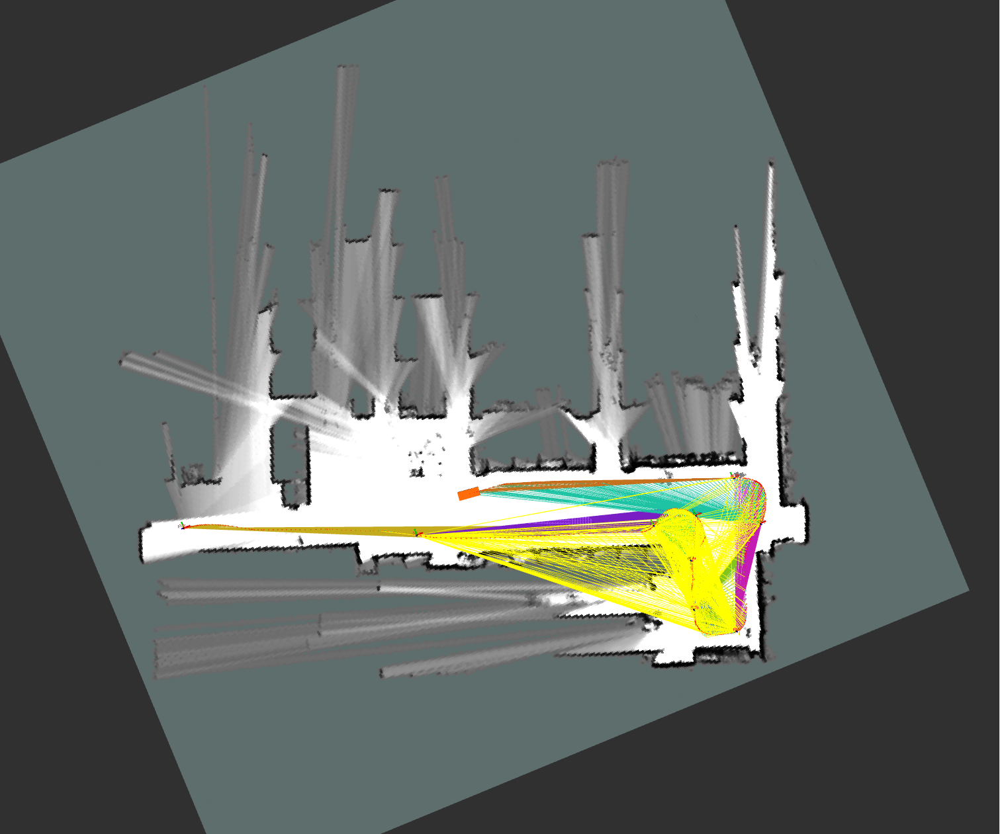
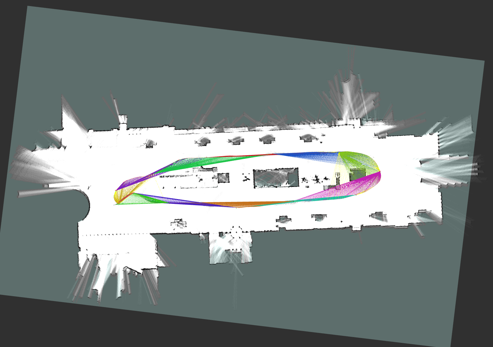

# B1-cartographer_ros
**B1-cartographer_ros** is a real-time SLAM framework for 2D Lidar-Inertial Systems. It is developed on the basis of cartographer. 
# 1. Download
- clone repository into your ROS2 workspace  
    ```
    cd ~/ros2_ws/src  
    git clone git@github.com:zzhh00/B1-2dLidar-SLAM.git
    ```
# 2. Prerequisites
- Ubuntu 20.04(focal) + ROS2(galactic/foxy)
- copy `B1-carto-lib-build.sh` to your path for 3rd library
- run `./B1-carto-lib-build.sh` to install dependencies

# 3. Build B1-cartographer_ros
- Open the terminal and compile B1-cartographer_ros  
  ```
  cd ..  
  colon build
  ```

# 4. Run B1-cartographer_ros
## Launch mapping
- Set environment variables  
  ```
  source install/setup.bash
  ```
- Begin mapping
  ```
  ros2 launch cartographer_ros B1-2d_mapping_indoor.launch.py
  ``` 
- Finish mapping and save map as `.pgm` and `.yaml`
  Open a new terminator and type command 
  ```
  cd ~/ros2_ws/src/B1-2dLidar-SLAM/SLAM_tools
  ./B1-carto_save_2d_map.sh
  ```
  Note that the path in the script should be modified according to the actual value;

## Launch localization
- Begin localization based on prior pbstream map, the path of `.pbstream` file should be modified in launch file according to the actual value
  ```
  ros2 launch cartographer_ros B1-2d_localization_indoor.launch.py
  ``` 
- Play ROS bag to subscribe sensor msg

  ```
  ros2 bag play -s rosbag_v2 xxxxx.bag --topics /imu /odom /scan
  ``` 
  or remapping the subscribed topics in launch file;
# 5. Topics(Input/Output)
## Subscribed topics


## Published topics


## Exposed Services


# 6. Configuration

## Solver Params


## Params


## Matcher Params

# 7. Demo
## Mapping
### Test on GS-market_9-28 dataset

- Launch file: `B1-2d_mapping_indoor.launch.py`
- Input topic:
  - /scan (sensor_msgs/msg/LaserScan)
  - /odom (nav_msgs/msg/Odometry)
- Output topic:
  - /map (nav_msgs/msg/OccupancyGrid)
### Test on rslidar-outdoor-gps dataset

- Launch file: `test_mapping_hz.launch.py`
- Input topic:
  - /front_scan (sensor_msgs/msg/LaserScan)
  - /odom_scout (nav_msgs/msg/Odometry)
  - /imu (sensor_msgs/msg/Imu)
- Output topic:
  - /map (nav_msgs/msg/OccupancyGrid)
## Localization


## Development log
- **[2023.07.31]**
  - Support the initial localization through rotation in place;
  - Disable the map update during localization;

- **[2023.08.02]**
  - Publish the pose of tracking_frame in carto_odom frame/current map frame;
  - Publish the tf between carto_odom frame/current map frame and published_frame;

# Todo list
- [ ] Add detailed comments
- [x] Support ROS2(foxy)
- [x] Fix the error - the static tf can not be looked up when playing bag transformed from ros1 bag  
  （Actually the error "local_trajectory_builder_2d.cc:218] Dropped empty horizontal range data" is caused by the positive value of param "z_min" in lua file, the error disappears when ".z_min" is commented.）
- [x] Support map saving
- [x] Support pure localization mode 
- [x] Support initial localization through rotation in place
- [ ] Support publishing pose(base_footprint in map) or tf(odom to base_footprint) as localization result 
- [ ] Support initial localization without any action(it is possible through test, but is takes a long time to finish initial localization)
- [ ] Support localization mode base on prior pbstream
- [ ] Publish tf between odom and base_footprint as the localization result
- [ ] (To be optimized) Support the configuration of two lidars in B1
- [ ] (To be optimized) Add pre-integration of IMU and Odom
- [ ] (To be optimized) Improve the time squence based loop-closure-detection(LCD)/relocalization  
- [ ] Add map merging
- [ ] Make the rviz plugin adaptive to ROS2
- [ ] Clip useless codes to make cartographer concise  
- [ ] Support gRPC server
- [ ] Support LLM control through GPT-4
- [ ] Add test cases and results
- [ ] Refactor the code